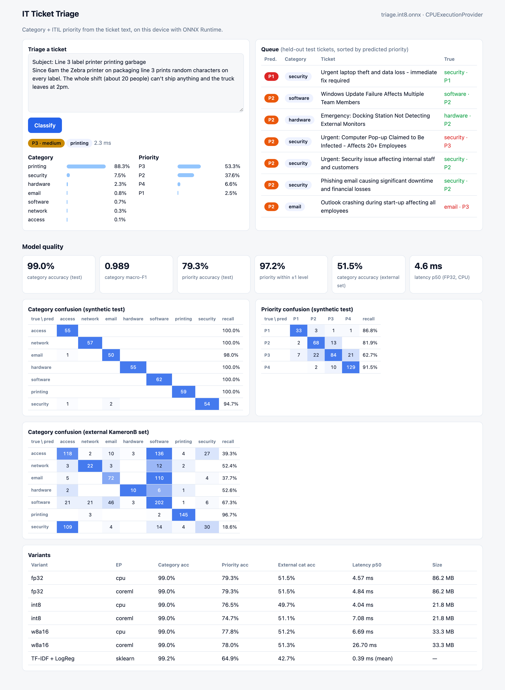
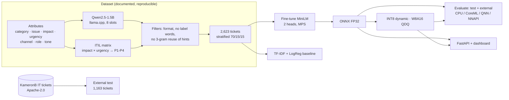

# it-ticket-triage

[](https://github.com/RobiiAragon/it-ticket-triage/actions/workflows/ci.yml)


[English](README.md) · **Español**

**Lee un ticket de TI y predice su categoría y su prioridad ITIL (P1–P4) en ~4 ms, en el
propio dispositivo.** El modelo es un MiniLM fine-tuned con dos cabezas, exportado a ONNX
(FP32, INT8, W8A16) y servido con FastAPI y un dashboard. El repo también incluye un dataset
sintético documentado generado con un LLM local, una línea base TF-IDF, matrices de confusión
y una prueba honesta fuera de dominio con otro dataset público.



- **Modelo:** `all-MiniLM-L6-v2` (22M parámetros, Apache-2.0) con mean pooling y dos cabezas
  lineales (7 categorías, 4 prioridades), entrenadas juntas con pérdida ponderada por clase para
  prioridad, en 41 s sobre MPS de Apple. El ONNX ya devuelve probabilidades softmax.
- **Inferencia en el dispositivo:** ONNX Runtime + un **tokenizer WordPiece en Python puro**
  (sin PyTorch ni el wheel de Rust de `tokenizers`), así que corre igual en Termux. Detecta
  los EPs (CPU, CoreML, QNN, CUDA, NNAPI, XNNPACK) y usa shapes estáticos para los
  aceleradores.
- **Cuantización:** INT8 dinámica, incluyendo los embeddings (86 MB → 22 MB), y QDQ W8A16,
  que es la receta para NPUs.
- **Datos auditables:** 5,110 tickets generados por Qwen2.5-1.5B con llama.cpp a partir de
  atributos explícitos. La prioridad sale de la **matriz ITIL impacto × urgencia**, y un filtro
  de fugas eliminó los 2,487 tickets que reusaban las pistas del generador.
- **API y dashboard:** `POST /classify`, `POST /classify/batch`, `GET /queue` y `GET /metrics`,
  con matrices de confusión de categoría (dentro y fuera de dominio) y de prioridad.

## Cómo funciona



## Inicio rápido

```bash
git clone https://github.com/RobiiAragon/it-ticket-triage && cd it-ticket-triage
python3.12 -m venv .venv && source .venv/bin/activate
pip install -e ".[dev]"

triage download-models --variant int8      # 22 MB del release de GitHub, SHA-256 verificado
triage classify "Whole packing line 3 can't print shipping labels and the truck leaves at noon"
triage serve                               # dashboard en http://127.0.0.1:8000, API en /docs
```

Para reproducir todo (`pip install -e ".[dev,train]"`):

```bash
llama-server -hf Qwen/Qwen2.5-1.5B-Instruct-GGUF:Q4_K_M -c 16384 -np 8 --port 8080 &
triage generate --n 6000 --url http://127.0.0.1:8080/v1   # ~26 min en un M5 Max
triage prepare        # deduplicar, filtro de fugas, split estratificado, set externo
triage train          # fine-tuning (10 épocas), exportar ONNX, cuantizar
triage evaluate --baseline --out results/mi-equipo.json
```

## El dataset

Los datasets públicos de tickets de TI no tienen prioridad, están dominados por una sola clase
(88% "SOFTWARE" en el más grande con Apache-2.0) o tienen licencias no comerciales. Por eso
este repo **genera** sus datos y documenta exactamente cómo:

1. **Atributos:** 7 categorías × 6–7 problemas concretos cada una; impacto (una persona, un
   equipo, un sitio/clientes) y urgencia (puede esperar, bloquea hoy, está parado ya), más
   canal, rol y tono, todo muestreado con semilla fija.
2. **Etiquetas por construcción:** la categoría es la muestreada y la **prioridad = matriz
   ITIL (impacto, urgencia)**.
3. **Generación:** Qwen2.5-1.5B-Instruct Q4_K_M con llama.cpp, temperatura 0.9, varias
   redacciones por pista e instrucciones de describir la situación con sus propias palabras.
4. **Filtros:** formato asunto + cuerpo, sin palabras como "priority/urgency/P1", sin 5-gramas
   copiados de las instrucciones (7,212 intentos rechazados), y luego el **filtro de fugas**.

**Por qué importa el filtro de fugas.** Después de generar encontré fragmentos de las pistas
que identifican la etiqueta 1:1: "5-30 people" en 215 tickets, *todos* de impacto medio;
"dozen colleagues" en 326, todos medios; "later this week" siempre urgencia baja. Un
clasificador aprendería esas frases y no la situación. `prepare` elimina todo ticket que reuse
un fragmento de 3 palabras (con ≥ 2 de contenido) de sus pistas: **2,487 de 5,110 eliminados,
2,623 conservados**. Todos los números reportados usan los datos filtrados.

**Auditoría de etiquetas.** Leí 50 tickets al azar (semilla 42, tomados antes del filtro). El
texto coincidía con su **categoría en 49/50** casos, pero respaldaba su **prioridad solo en
36/50 (72%)**: el generador de 1.5B a veces contradice sus propias instrucciones. Las
etiquetas de prioridad tienen ruido, lo que pone un techo a cualquier modelo.

**Set externo:** KameronB/synthetic-it-callcenter-tickets (Apache-2.0), con otro generador y
otra taxonomía: 1,163 tickets escritos por clientes, con las categorías mapeadas a las mías
(PIV CARD excluido). No tiene prioridad, así que mide **solo la generalización de categoría**.

## Resultados medidos en mi Mac

**Hardware:** MacBook Pro (Mac17,6), Apple **M5 Max**, 48 GB RAM, macOS 27.2.
**Software:** Python 3.12.16, onnxruntime 1.32.0, PyTorch 2.15.0 (MPS), transformers 5.23.0.
**Sets de prueba:** 396 tickets sintéticos apartados + 1,163 externos. La latencia es por
ticket individual (batch 1), p50 sobre 200 tickets, incluyendo la tokenización.

| Modelo | EP | Exactitud categoría (macro-F1) | Exactitud prioridad (macro-F1) | Prioridad a ±1 nivel | Categoría en set externo | Latencia p50 | Tamaño |
|---|---|---:|---:|---:|---:|---:|---:|
| TF-IDF + LogReg (línea base) | sklearn | **99.2%** (0.992) | 64.9% (0.628) | 94.4% | 42.7% | 0.39 ms (media) | — |
| **MiniLM FP32** | CPU | 99.0% (0.989) | **79.3%** (0.792) | 97.2% | **51.5%** | 4.57 ms | 86.2 MB |
| MiniLM FP32 | CoreML | 99.0% | 79.3% | 97.2% | 51.5% | 4.84 ms | 86.2 MB |
| MiniLM **INT8** (dynamic) | CPU | 99.0% (0.990) | 76.5% (0.762) | 97.5% | 49.7% | **4.04 ms** | **21.8 MB** |
| MiniLM INT8 | CoreML | 99.0% | 74.7% | 97.2% | 51.1% | 7.08 ms | 21.8 MB |
| MiniLM W8A16 (QDQ) | CPU | 99.0% | 77.8% (0.776) | 97.0% | 51.2% | 6.69 ms | 33.3 MB |
| MiniLM W8A16 | CoreML | 99.0% | 78.0% | 97.0% | 51.3% | 26.70 ms | 33.3 MB |

Recall de prioridad por clase (FP32): P1 86.8%, P2 81.9%, P3 62.7%, P4 91.5%. Los resultados INT8 dinámicos varían
un poco entre CPUs y builds de ORT: en los runners ubuntu/macOS de GitHub el mismo modelo INT8
da 99.5% en categoría y 75.3–75.8% en prioridad.

### Lo que aprendí

1. **La categoría es un problema de palabras clave; la prioridad, de comprensión del
   lenguaje.** En categoría, TF-IDF empata con el transformer (99.2% vs 99.0%). En prioridad, el
   transformer gana por **+14.4 puntos** (79.3% vs 64.9%): la urgencia y el impacto se expresan en
   frases como "el camión sale a las 2pm" o "todo el turno", no en palabras fijas.
2. **La mayoría de los errores de prioridad son de un nivel.** El 97.2% de las predicciones
   queda a ±1 nivel y la clase más difícil es P3. Con 72% de consistencia en la auditoría, 79%
   está cerca de lo que estos datos permiten.
3. **Los atajos se esconden en los datos generados.** Sin el filtro de fugas el dataset era el
   doble de grande y mucho más fácil por las razones equivocadas.
4. **El número honesto es el de fuera de dominio: 51.5%.** Impresión se transfiere casi
   perfecto (97% de recall). Lo demás es en parte *diferencia de taxonomía* (el set externo
   archiva problemas de login como SECURITY: 109 se predicen como access, que en mi taxonomía es
   correcto) y en parte *cobertura*: mi generador usó ~7 tipos de problema por categoría y no
   cubre la cola larga de nombres de aplicaciones. Entrenar con fuentes mixtas es lo primero en
   el roadmap.
5. **INT8 es el default correcto en CPU:** 4× más chico y el más rápido, por −2.8 puntos en
   prioridad. CoreML no ayuda a un modelo de 22M parámetros con batch 1, y W8A16 QDQ es lento
   en CoreML (26.7 ms) porque esos nodos QDQ corren en CPU. Ese formato está pensado para la NPU
   de Qualcomm vía el EP QNN.

Los hiperparámetros (10 épocas, lr 5e-5, longitud 160) se eligieron con validación; el test se
usó una sola vez.

## Correrlo en la Galaxy Tab S9 Ultra (Termux)

```bash
pkg install -y git
git clone https://github.com/RobiiAragon/it-ticket-triage && cd it-ticket-triage
bash scripts/android_termux_check.sh                 # INT8 (22 MB), CPU / XNNPACK / NNAPI
VARIANTS=int8,fp32 bash scripts/android_termux_check.sh
```

Instala NumPy y ONNX Runtime precompilados de Termux y luego este paquete con `--no-deps` (el
tokenizer es Python puro). Descarga el modelo del release, clasifica un ticket de ejemplo y
corre la evaluación completa por EP en `results/android-<modelo>.json`.

## Desarrollo

```bash
pip install -e ".[dev]"
ruff check . && ruff format --check . && pytest -q   # 15 pruebas: ONNX diminuto + LLM falso
scripts/mac_check.sh                                  # modelos del release -> eval CPU/CoreML -> API
TRAIN=1 scripts/mac_check.sh                          # + re-split, fine-tuning, export, cuantización
```

El CI (ubuntu + macOS, Python 3.11/3.12) corre lint y pruebas, descarga el modelo INT8 del
release, verifica su SHA-256 y **falla si la exactitud de categoría o la prioridad a ±1 nivel
bajan de 95%**.

## Roadmap

- [ ] Resultados de la tablet (Snapdragon 8 Gen 2: CPU / XNNPACK / NNAPI)
- [ ] Entrenar con fuentes mixtas (sintético + tickets públicos reales) para cerrar la brecha fuera de dominio
- [ ] Generador más grande (Qwen2.5-7B, Apache-2.0) y una segunda pasada de anotación para subir la consistencia de prioridad
- [ ] Tickets en español (MiniLM multilingüe) para una mesa de ayuda bilingüe
- [ ] Correr el modelo W8A16 con el EP QNN en Snapdragon vía Qualcomm AI Hub (ver edge-ai-bench)
- [ ] Ruteo por confianza: mandar tickets de baja confianza a una cola humana
- [ ] Reglas de política encima del modelo: la prioridad se aprende solo del impacto/urgencia
      escritos en el texto, así que *"le di clic a un link y escribí mi contraseña"* (sin impacto
      explícito) sale como security · P4. Una mesa real aplicaría reglas como "credenciales
      comprometidas ≥ P2".

## Licencia

Código y dataset generado: MIT © Jesús Aragón. `data/splits/external.jsonl` es un subconjunto
de KameronB/synthetic-it-callcenter-tickets (Apache-2.0). Modelo base:
sentence-transformers/all-MiniLM-L6-v2 (Apache-2.0). Generador: Qwen2.5-1.5B-Instruct
(Apache-2.0).
