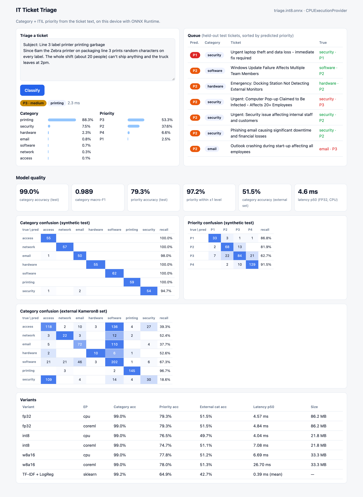
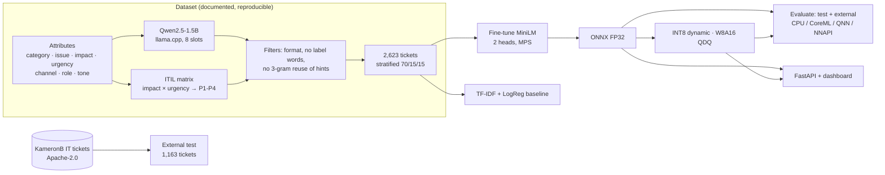

# it-ticket-triage

[](https://github.com/RobiiAragon/it-ticket-triage/actions/workflows/ci.yml)


**English** · [Español](README.es.md)

**Reads an IT ticket and predicts its category and ITIL priority (P1–P4) in ~4 ms, on
the device.** The model is a fine-tuned MiniLM with two heads, exported to ONNX (FP32,
INT8, W8A16) and served with FastAPI plus a dashboard. The repo also includes a documented
synthetic dataset built with a local LLM, a TF-IDF baseline, confusion matrices, and an
honest out-of-domain test on a different public dataset.



- **Model:** `all-MiniLM-L6-v2` (22M params, Apache-2.0) with mean pooling and two linear heads
  (7 categories, 4 priorities), trained jointly with a class-weighted priority loss in
  41 s on Apple MPS. The ONNX export outputs softmax probabilities directly.
- **On-device inference:** ONNX Runtime plus a **pure-Python WordPiece tokenizer** (no
  PyTorch, no Rust `tokenizers` wheel), so it runs unchanged in Termux on Android. EP
  detection covers CPU, CoreML, QNN, CUDA, NNAPI and XNNPACK, with static shapes for
  accelerator EPs.
- **Quantization:** INT8 dynamic, embeddings included (86 MB → 22 MB), and QDQ W8A16, the
  recipe used for NPUs.
- **Data you can audit:** 5,110 tickets generated by Qwen2.5-1.5B through llama.cpp from
  explicit attributes. Priority comes from the **ITIL impact × urgency matrix**, and a
  leakage filter removed the 2,487 tickets that reused the generator's hint wording.
- **API and dashboard:** `POST /classify`, `POST /classify/batch`, `GET /queue`, and
  `GET /metrics`, with confusion matrices for category (in- and out-of-domain) and priority.

## How it works



## Quickstart

```bash
git clone https://github.com/RobiiAragon/it-ticket-triage && cd it-ticket-triage
python3.12 -m venv .venv && source .venv/bin/activate
pip install -e ".[dev]"

triage download-models --variant int8      # 22 MB from the GitHub release, SHA-256 checked
triage classify "Whole packing line 3 can't print shipping labels and the truck leaves at noon"
triage serve                               # dashboard at http://127.0.0.1:8000, API docs at /docs
```

```bash
curl -s localhost:8000/classify -H 'Content-Type: application/json' \
     -d '{"text": "I clicked a link in an email and typed my password, now I get MFA prompts"}'
```

Reproduce everything (`pip install -e ".[dev,train]"`):

```bash
llama-server -hf Qwen/Qwen2.5-1.5B-Instruct-GGUF:Q4_K_M -c 16384 -np 8 --port 8080 &
triage generate --n 6000 --url http://127.0.0.1:8080/v1   # ~26 min on an M5 Max
triage prepare        # dedupe, leakage filter, stratified split, download external set
triage train          # fine-tune (10 epochs), export ONNX, quantize -> models/
triage evaluate --baseline --out results/my-machine.json
```

## The dataset

Public IT-ticket datasets either have no priority label, are dominated by one class (88%
"SOFTWARE" in the largest Apache-2.0 one), or carry non-commercial licenses. So this repo
**generates** its training data and documents exactly how:

1. **Attributes:** 7 categories × 6–7 concrete issues each (e.g. *"badge release at the
   printer does not work"*), impact ∈ {one person, a team, a site/customers}, urgency ∈ {can
   wait, blocks today, stopped now}, plus channel, role and tone, all sampled with a fixed
   seed. See [`taxonomy.py`](src/ticket_triage/taxonomy.py) and [`synth.py`](src/ticket_triage/synth.py).
2. **Labels by construction:** category = the sampled category; **priority = ITIL matrix
   (impact, urgency)**: high/high → P1, high/med or med/high → P2, … low/low → P4.
3. **Generation:** Qwen2.5-1.5B-Instruct Q4_K_M via llama.cpp, temperature 0.9, several
   phrasings per hint, and an instruction to describe the situation in its own words.
4. **Filters:** subject + body format, no words like "priority/urgency/P1", no 5-gram copied
   from the instructions (at generation time; 7,212 rejected attempts), and then the
   **leakage filter**.

**Why the leakage filter matters.** After generating I found the model reusing hint
fragments that map 1:1 to a label: "5-30 people" in 215 tickets, *all* medium impact;
"dozen colleagues" in 326, all medium; "later this week" always low urgency. A classifier
would learn those phrases instead of the situation. `prepare` drops every ticket that reuses
a 3-word run (with ≥ 2 content words) of its impact/urgency hint: **2,487 of 5,110
removed, 2,623 kept**. All reported numbers use the filtered data.

**Label-quality audit.** I read 50 random tickets (seed 42, drawn before the leakage filter).
The text matched its **category in 49/50** cases, but supported its **priority in only 36/50
(72%)**: the 1.5B generator sometimes contradicts its own instructions (e.g. a "single user"
ticket mentioning ten departments). Priority labels are therefore noisy, which puts a ceiling
on any model's priority accuracy.

**External test set:** [KameronB/synthetic-it-callcenter-tickets](https://huggingface.co/datasets/KameronB/synthetic-it-callcenter-tickets)
(Apache-2.0), a different generator and taxonomy. Customer-written tickets only; categories
mapped ACCOUNT→access, EMAIL→email, NETWORK→network, PRINTER→printing, SECURITY→security,
HARDWARE→hardware, SOFTWARE→software (PIV CARD excluded as ambiguous); ≤ 300 per class →
1,163 tickets. It has no priority, so it measures **category generalization only**.

## Results: measured on my Mac

**Hardware:** MacBook Pro (Mac17,6), Apple **M5 Max**, 48 GB RAM, macOS 27.2.
**Software:** Python 3.12.16, onnxruntime 1.32.0, PyTorch 2.15.0 (MPS for training),
transformers 5.23.0. **Test sets:** 396 synthetic tickets (held out, stratified) and
1,163 external tickets. Latency is batch 1, single ticket, p50 over 200 tickets, including
tokenization. Raw data: [`results/mac-m5max.json`](results/mac-m5max.json).

| Model | EP | Category acc (macro-F1) | Priority acc (macro-F1) | Priority within ±1 | External category acc | Latency p50 | Size |
|---|---|---:|---:|---:|---:|---:|---:|
| TF-IDF + LogReg (baseline) | sklearn | **99.2%** (0.992) | 64.9% (0.628) | 94.4% | 42.7% | 0.39 ms (mean) | — |
| **MiniLM FP32** | CPU | 99.0% (0.989) | **79.3%** (0.792) | 97.2% | **51.5%** | 4.57 ms | 86.2 MB |
| MiniLM FP32 | CoreML | 99.0% | 79.3% | 97.2% | 51.5% | 4.84 ms | 86.2 MB |
| MiniLM **INT8** (dynamic) | CPU | 99.0% (0.990) | 76.5% (0.762) | 97.5% | 49.7% | **4.04 ms** | **21.8 MB** |
| MiniLM INT8 | CoreML | 99.0% | 74.7% | 97.2% | 51.1% | 7.08 ms | 21.8 MB |
| MiniLM W8A16 (QDQ) | CPU | 99.0% | 77.8% (0.776) | 97.0% | 51.2% | 6.69 ms | 33.3 MB |
| MiniLM W8A16 | CoreML | 99.0% | 78.0% | 97.0% | 51.3% | 26.70 ms | 33.3 MB |

Priority recall per class (FP32): P1 86.8%, P2 81.9%, P3 62.7%, P4 91.5%. Dynamic-INT8 results shift slightly
across CPUs and ORT builds: on GitHub's ubuntu/macOS runners the same INT8 model scores 99.5%
category and 75.3–75.8% priority. The confusion
matrices are in the dashboard and in the results JSON.

### What I learned

1. **Category is a keyword problem; priority is a language-understanding problem.** On
   category, TF-IDF ties the transformer (99.2% vs 99.0%). On priority, the transformer wins by
   **+14.4 points** (79.3% vs 64.9%): urgency and impact are expressed in phrases like "the
   truck leaves at 2pm" or "the whole shift", not in fixed keywords.
2. **Most priority errors are one level off.** 97.2% of predictions are within ±1 level, and
   the hardest class is P3, which sits between "important" and "can wait". With 72% label
   consistency in the audit, 79% accuracy is close to what this data allows.
3. **Shortcuts hide in generated data.** Without the leakage filter, the dataset was twice as
   large and much easier for the wrong reasons. Filtering cost half the data but means the model
   reads situations, not generator artifacts.
4. **The honest number is the out-of-domain one: 51.5%.** Printing transfers almost perfectly
   (97% recall). The rest is partly *taxonomy mismatch* (the external set files login problems
   under SECURITY, so 109 of them get predicted as access, which is right in my taxonomy) and
   partly *coverage*: my generator used ~7 issue types per category, so it struggles with the
   long tail of application names (e.g. an IBM Watson install request predicted as email).
   Training on mixed sources is the top roadmap item.
5. **INT8 is the right default on CPU:** 4× smaller and the fastest, for −2.8 points of
   priority accuracy. CoreML doesn't help a 22M-parameter model at batch 1, and W8A16 QDQ is
   slow on CoreML (26.7 ms) because those QDQ nodes run on CPU. That format is meant for the
   Qualcomm NPU via the QNN EP.

Hyper-parameters (10 epochs, lr 5e-5, max length 160) were chosen on the validation split;
the test split was used once.

## Run it on the Galaxy Tab S9 Ultra (Termux)

```bash
pkg install -y git
git clone https://github.com/RobiiAragon/it-ticket-triage && cd it-ticket-triage
bash scripts/android_termux_check.sh                 # INT8 (22 MB), CPU / XNNPACK / NNAPI
VARIANTS=int8,fp32 bash scripts/android_termux_check.sh
```

It installs Termux's prebuilt NumPy and ONNX Runtime, then this package with `--no-deps` (the
tokenizer is pure Python). It downloads the model from the release, classifies a sample ticket,
and runs the full evaluation per EP into `results/android-<model>.json`. The FastAPI dashboard
isn't installed on Termux (`pydantic-core` has no Android wheel).

## Development

```bash
pip install -e ".[dev]"
ruff check . && ruff format --check . && pytest -q   # 15 tests: tiny ONNX model + fake LLM server
scripts/mac_check.sh                                  # release models -> eval CPU/CoreML -> API
TRAIN=1 scripts/mac_check.sh                          # + re-split, fine-tune, export, quantize
```

CI (ubuntu + macOS, Python 3.11/3.12) runs lint and the tests, then downloads the released
INT8 model, verifies its SHA-256, and **fails if test category accuracy or priority-within-±1
drops below 95%**.

## Roadmap

- [ ] Tablet results (Snapdragon 8 Gen 2: CPU / XNNPACK / NNAPI) in this README
- [ ] Mixed-source training (synthetic + real public tickets) to close the out-of-domain gap
- [ ] Larger generator (Qwen2.5-7B, Apache-2.0) and a second annotator pass to raise priority-label consistency above 72%
- [ ] Spanish tickets (multilingual MiniLM) for a bilingual service desk
- [ ] QNN EP run of the W8A16 model on Snapdragon via Qualcomm AI Hub (see edge-ai-bench)
- [ ] Confidence-based routing: send low-confidence tickets to a human queue
- [ ] Policy floors on top of the model: priority is learned only from impact/urgency stated in
      the text, so *"I clicked a link and typed my password"* (no stated impact) comes out as
      security · P4. A real desk would apply rules like "credential compromise ≥ P2".

## License

Code and the generated dataset (`data/synthetic`, `data/splits` except `external.jsonl`): MIT ©
Jesús Aragón. `data/splits/external.jsonl` is a subset of KameronB/synthetic-it-callcenter-tickets
(Apache-2.0). Base model: sentence-transformers/all-MiniLM-L6-v2 (Apache-2.0). Generator:
Qwen2.5-1.5B-Instruct (Apache-2.0).
